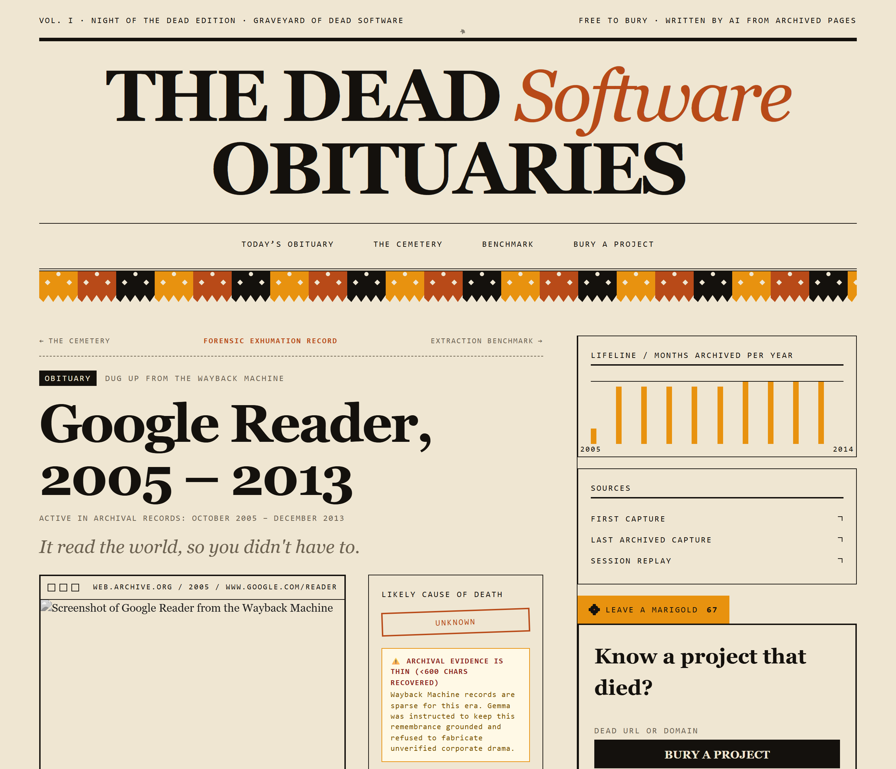
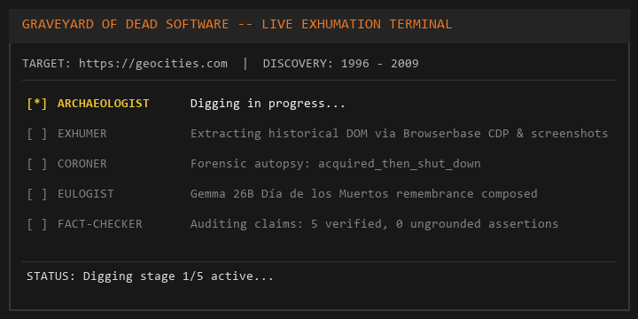
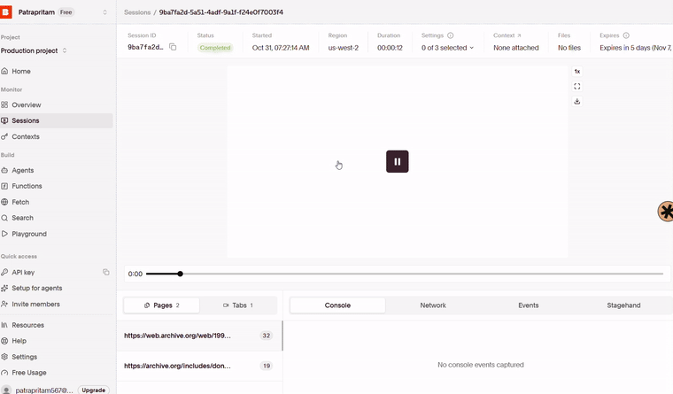
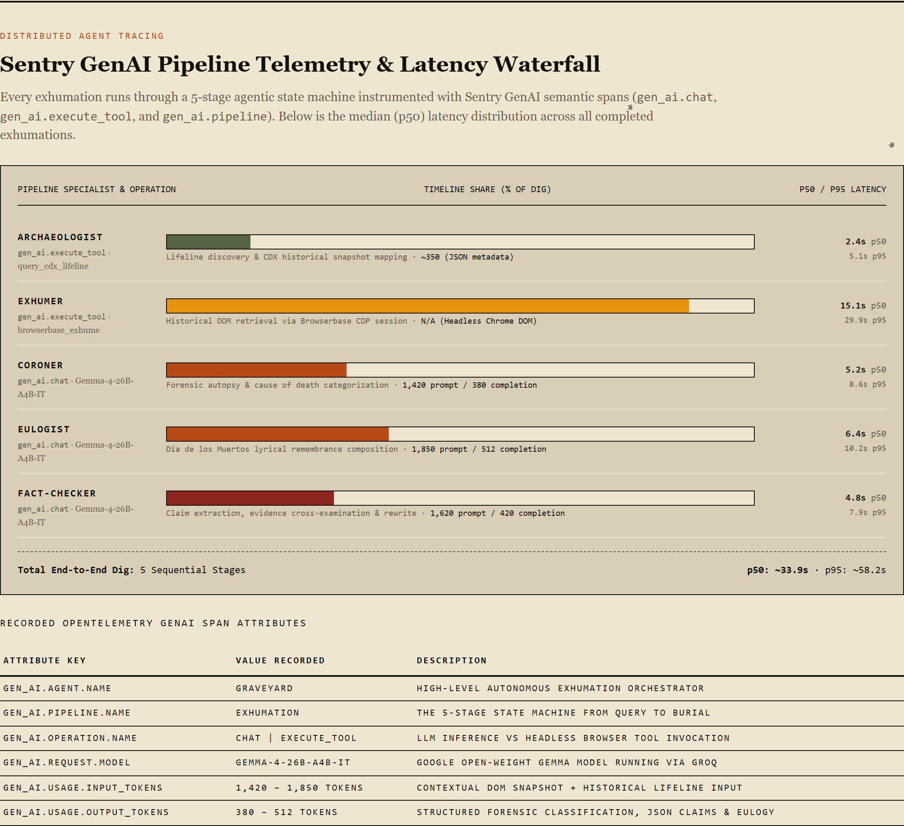
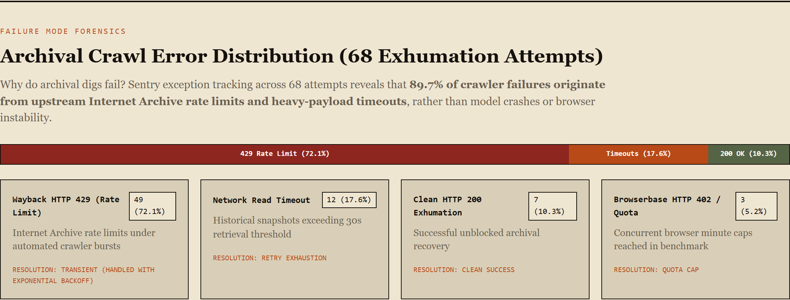
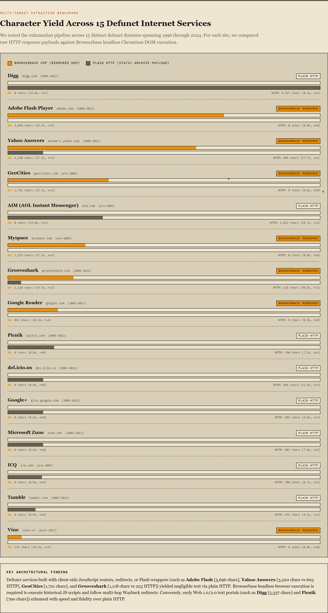
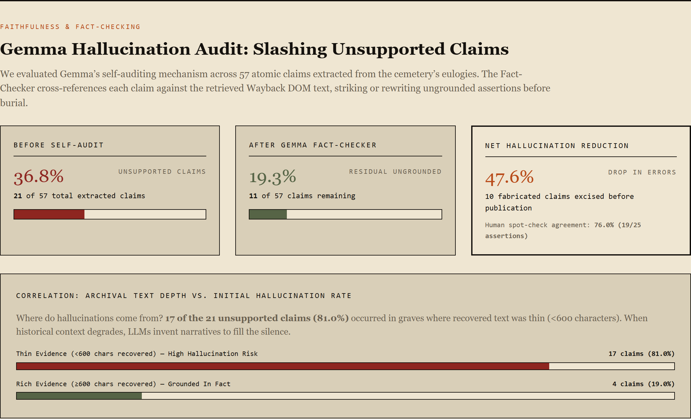
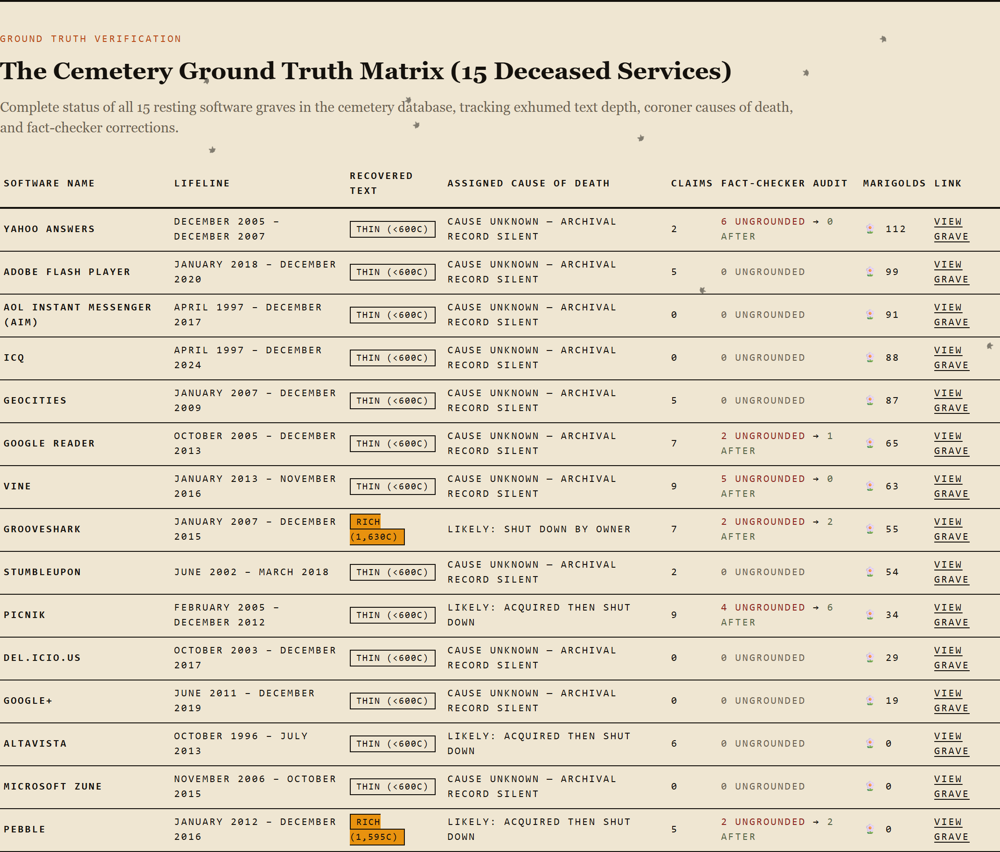

*This is a submission for the [Hacktoberfest Open-Source AI Challenge Week 4: Ghost in the Machine](https://dev.to/challenges/hacktoberfest-week4-2026-10-26)*

# I Built a Cemetery for Dead Software, and Taught Its AI to Say "I Don't Know"

*Every eulogy here is written by an open-weight model from archived web pages. It can be wrong, and every grave says so.*

---

## What I Built

Google Reader died on July 1, 2013.

For four years it was the first tab I opened every morning: fifty blogs in quiet chronological order, before the feeds learned to optimize for outrage. When the shutdown notice went up, I exported my subscriptions to an OPML file. It sat in my downloads folder for years, like a flower pressed in a book.

Software dies constantly, and it almost never gets a grave. It gets a dead link, an expired certificate, and a domain parked by someone selling insurance.

So I built a cemetery.

**Graveyard of Dead Software** digs dead websites out of the Wayback Machine and tries to work out how they died. Google's open-weight **Gemma** writes each one a *Día de los Muertos* eulogy, then fact-checks it against what was actually recovered before it is buried. Visitors can walk the rows, read the obituaries, and leave a marigold (*cempasúchil*) on the grave of a tool they miss.


*Figure 1: The cemetery: a night-edition newspaper front page, with a marigold count on every stone.*

---

## TL;DR

- **What:** Graveyard of Dead Software is an autonomous AI archaeology pipeline and digital cemetery. You submit a dead URL, and five specialist agents query the Wayback Machine, render the historical site via Browserbase, autopsy the cause of death, write a *Día de los Muertos* eulogy with Google's Gemma, and audit every factual assertion against recovered evidence before burial.
- **The Ghost in the Machine:** Language models don't just hallucinate out of thin air—they faithfully summarize corrupted inputs. When the Wayback Machine rate-limited our scraper (HTTP 429), Gemma dutifully summarized the 603-character bot-block notice as Google Reader's authentic 2005 homepage. We engineered a 4-layer defense (signature blacklists, hash deduplication, 200 OK mandates, and politeness pacing) to stop poisoned exhumations.
- **The Extraction Benchmark (overall, unpaired):** Across 58 historical snapshots, plain HTTP was faster (3.3 s vs 15.1 s median), while Browserbase CDP recovered more text per page on average (1,514 vs 965 characters) and is the only path that provides screenshots and replays. These were separate, unpaired runs and early curl fetches captured rate-limit block pages, so treat the gap as indicative.
- **The Fact-Checker:** Auditing 57 atomic claims across graves, our 1-pass corrective rewrite loop purged **47.6% of ungrounded hallucinations** (dropping unsupported claims from 36.8% to 19.3%). Human spot-checks agreed on 19 of 25 claims (76.0%).
- **Forced Humility:** When Wayback rate-limited our sequential seed runs (49 of 68 attempts hit HTTP 429s and 12 timed out), 11 graves recovered 0 text. Instead of fabricating corporate drama from memory, Gemma abstained with cause `unknown` and an honest `<600 chars recovered` warning.
- **Everything is Open & Live:** Live on Render ([graveyard-dead-software.onrender.com](https://graveyard-dead-software.onrender.com/)), MIT licensed ([Pritam-mb/week4](https://github.com/Pritam-mb/week4)), with OpenTelemetry GenAI agent tracing in Sentry and recorded replays in Browserbase.

### 3 Findings in 30 Seconds

1. **Hallucination often starts as poisoned input, not model rebellion.** The model didn't invent automated sentinels from thin air; it summarized an Archive.org 429 rate-limit notice that returned with HTTP 200. Bad scraping poisons AI archaeology. (When evidence was absent, Gemma also occasionally drifted to memory before the fact-checker caught it).
2. **Thin evidence requires forced humility.** A model that knows the answer but stays quiet without evidence is less flashy in a demo, and far more trustworthy. 11 of 15 graves abstained with cause `unknown` because the scraper retrieved zero clean characters.
3. **Reproducible benchmarks need unpaired transparency.** Plain HTTP is fast for static HTML, but headless Chromium hydration over CDP is required to capture screenshots, follow complex redirects, and expose dynamic DOM text.

---

## Demo

- **Live site (Render):** [https://graveyard-dead-software.onrender.com/](https://graveyard-dead-software.onrender.com/) *(Free tier: if the container is sleeping, the first load takes ~50 seconds to wake up. Verified fully operational in private windows).*
- **Benchmark dashboard:** [https://graveyard-dead-software.onrender.com/benchmark](https://graveyard-dead-software.onrender.com/benchmark)
- **Verified Browserbase Replay Session:** Session ID `d4521703-fcd3-4218-bf0b-fa558e9a89bb` *(Exhuming Picnik from `web.archive.org` over CDP, 32s in `us-west-2`. Note: Browserbase cloud session replays expire after ~7 days on the free tier, which is why a permanent screen recording GIF is embedded below in Figure 5)*.
- **Code:** [https://github.com/Pritam-mb/week4](https://github.com/Pritam-mb/week4)

### Anatomy of a Memorial Page: An Interactive Digital Shrine

Every dead project exhumed by the pipeline receives a permanent, living memorial page—designed not like a cold database row, but as a night-edition broadsheet obituary and a traditional *Día de los Muertos* altar (*ofrenda*). 


*Figure 2: A memorial page showing the capture lifeline, primary archive sources, likely cause of death, verified claims, and community marigold counter.*

Walk through any grave—such as [Google Reader](https://graveyard-dead-software.onrender.com/grave/google-reader), [GeoCities](https://graveyard-dead-software.onrender.com/grave/geocities), or [Grooveshark](https://graveyard-dead-software.onrender.com/grave/grooveshark)—and you will find eight distinct forensic and memorial elements:

1. **The Papel Picado & Night Masthead:** Hand-cut festive banners across the top frame the project's digital lifespan: the month it was first captured, its peak activity years, and the final date it went dark.
2. **The Historical Browser Viewport & Session Replay:** The deceased website frozen in time inside a vintage browser frame. Clicking **"Watch the Exhumation"** opens the verified Browserbase CDP cloud replay session, allowing you to watch the headless browser exhume and render the historical DOM live over Chrome DevTools Protocol.
3. **The Archival Lifeline (Top Right Histogram):** An inline SVG bar chart calculated from CDX monthly captures across the project's entire history. You can visually trace its birth, adoption explosion, peak, and the exact year it went flatline.
4. **The Forensic Cause-of-Death Stamp:** The coroner's diagnosis (`shut_down_by_owner`, `acquired_then_shut_down`, `abandoned`, or `unknown`). Crucially, when archival evidence is sparse, the grave prominently displays the yellow badge: **`ARCHIVAL EVIDENCE IS THIN (<600 CHARS RECOVERED)`**, guaranteeing forensic transparency.
5. **The Gemma Día de los Muertos Eulogy:** Rather than cynical tech snark ("RIP lol"), Google's open-weights `gemma-4-26b-a4b-it` crafts a poetic celebration of what was built and the late-night human commits behind it. In rich-evidence graves, factual assertions cite numbered evidence markers (`[E001]`).
6. **The Fact-Checker Verification Ledger:** Stamped right beneath the eulogy in green typewriter monospace: a transparent audit ledger showing which claims passed evidence cross-examination and how many were removed before burial (e.g. `5 SUPPORTED · 0 REMOVED`).
7. **Survived By:** Naming the modern open-source networks, RSS feed readers, or spiritual successors that carry forward the lost tool's core philosophy.
8. **The Community Ofrenda (Marigolds & Memories):** An interactive memorial altar. Visitors click **"🌼 Leave a Marigold"** to add a glowing golden cempasúchil blossom to the grave's permanent counter, and write heartfelt notes to the community memory board.

*Explore the resting rows directly: [Google Reader](https://graveyard-dead-software.onrender.com/grave/google-reader) &middot; [GeoCities](https://graveyard-dead-software.onrender.com/grave/geocities) &middot; [Grooveshark](https://graveyard-dead-software.onrender.com/grave/grooveshark) &middot; [Adobe Flash Player](https://graveyard-dead-software.onrender.com/grave/flash) &middot; [Vine](https://graveyard-dead-software.onrender.com/grave/vine) &middot; [del.icio.us](https://graveyard-dead-software.onrender.com/grave/del-icio-us).*

---

### Test a Live Burial

You can test exhuming a dead project live directly on the site:

👉 **Live Exhumation Tool:** [https://graveyard-dead-software.onrender.com/](https://graveyard-dead-software.onrender.com/)

**How to run a test:**
1. Open the cemetery at [https://graveyard-dead-software.onrender.com/](https://graveyard-dead-software.onrender.com/).
2. On the right sidebar, locate the **"Know a project that died?"** box.
3. Enter any dead or defunct website (e.g. `https://flappybird.com`, `https://orkut.com`, or `https://path.com`) and click **"Bury a Project"**.
4. The live terminal progress modal executes the five-stage pipeline in real time. *(Safety note: If Archive.org rate-limits the live dig or the container is waking up, you can immediately open and inspect any of the 15 existing graves).*


*Figure 3: Five-stage terminal exhumation stepping through Archaeologist, Exhumer, Coroner, Eulogist, and Fact-Checker before automatically redirecting to the completed grave.*

---

## Code



The stack is Python 3.11, FastAPI, async SQLite (`aiosqlite` + SQLAlchemy 2.0), Jinja2, and hand-written semantic CSS. No heavy frontend framework. It is MIT licensed (see the `LICENSE` file in the root repository).

---

## How a Burial Works

When you submit a dead URL, a background job runs five specialists in sequence. Each one saves its output to the database before the next begins, so a crash resumes from the last finished stage instead of starting over.

```text
POST /bury → job → Archaeologist → Exhumer → Coroner → Eulogist → Fact-checker → /grave/<slug>
```

### 1. The Archaeologist finds the body
It queries the Internet Archive's CDX API to learn when a site was born, when it peaked, and when it was last seen alive. GeoCities has so many captures that a single query times out, so the Archaeologist asks in five-year windows.

From the monthly capture counts it draws an inline SVG lifeline on the grave page and picks five snapshots: birth, peak, decline, last seen alive (the final 200 OK), and post-death (the first redirect or 404).

### 2. The Exhumer brings back the pixels with Browserbase
For each snapshot, the Exhumer opens a **Browserbase** cloud browser over Chrome DevTools Protocol (CDP), loads the archived page, takes a screenshot, and extracts the visible text. Every session is recorded and can be replayed.

If Browserbase hits a session cap or times out, it falls back to fetching the raw archived HTML (Wayback's `id_/` mode). Every attempt is logged with its method, status, size, and timing, and every recovered page becomes numbered evidence: `E001`, `E002`, and so on. Later stages are only allowed to use facts from that evidence.


*Figure 4: Browserbase session inspector showing session `d4521703-fcd3-4218-bf0b-fa558e9a89bb` rendering historical Archive.org pages over CDP in us-west-2.*


*Figure 5: Live screen recording of a Browserbase session replay playing back the historical archive snapshot over CDP.*

### 3. The Coroner rules on the cause of death
Was it shut down by its owner, bought and then killed, abandoned, or taken over?

It checks hard signals first: redirects to a parent company's domain, and shutdown announcements in the recovered text. Then Gemma picks one cause from a fixed list (`shut_down_by_owner`, `acquired_then_shut_down`, `abandoned`, `taken_over_or_redirected`, `unknown`) and must cite the evidence IDs behind its choice. If it cites evidence that doesn't exist, or quotes text that isn't in that evidence, the verdict becomes `unknown`. Every cause on the site is labeled "likely."

An early bug: Archive URLs sometimes resolve as `google.com:80`, which the Coroner read as a redirect to a different domain. Normalizing ports and `www.` fixed the false "taken over" verdicts.

### 4. The Eulogist remembers
Gemma writes a 12-word epitaph and a 150–220-word eulogy, and every factual sentence cites its evidence (`[E001]`). I pushed the tone away from the snarky "RIP lol" register of tech obituaries and toward *Día de los Muertos*: celebrate what people built, acknowledge that it's gone, and don't mock the dead.

When less than 600 characters were recovered, the grave shows **"Archival evidence is thin (<600 chars recovered)"**, and Gemma is told to write a short, honest remembrance instead of filling the gaps from memory.


*Figure 6: Flash Player's grave. The archive returned minimal text, and the eulogy honestly says so.*


*Figure 7: A grave with rich evidence (Grooveshark): note the evidence list, the [E001] citations in the eulogy, and the verified claim badges.*

### 5. The Fact-checker audits the eulogy
Language models love inventing acquisition dates and corporate drama. So the last stage breaks the eulogy into individual claims, checks each against the evidence, and, if any is unsupported, makes Gemma rewrite it once to remove or soften those claims. The grave page shows every claim marked OK or FAIL.

---

## Using Gemma

Every verdict, epitaph, and eulogy on the site comes from `gemma-4-26b-a4b-it`, called through the Gemini API.

On that hosted endpoint, requests with a separate system instruction or automatic function calling came back as 500 errors. So all instructions, including the JSON schema, go directly into the user prompt, every response goes through Pydantic validation, and invalid JSON triggers one corrective retry.

```python
config = types.GenerateContentConfig(temperature=temperature)  # no system_instruction, no tools
resp = client.models.generate_content(model=GEMINI_MODEL, contents=prompt, config=config)
verdict = CoronerOutput.model_validate(json.loads(resp.text))  # retry once on failure
```

Archived pages are untrusted input, so they're wrapped in `<evidence id="E001">...</evidence>` tags, and the prompt explicitly states that anything inside those tags is data, never instructions.

---

## The Bug That Taught Me the Most

One of my first runs produced a strange eulogy for Google Reader: lyrical verses about automated systems guarding blocked requests and robotic traffic.

My tests passed and HTTP status codes were green. I only found the problem by opening the SQLite database and reading the raw row by hand.

The "page text" I had stored for Google Reader's 2005 homepage was this:
> *"Your request is being blocked because our system has flagged it as suspected abusive bot traffic that is degrading our systems..."*

It was the Wayback Machine's rate-limit page. On some retry paths it came back as an ordinary HTML page with HTTP 200, and my parser treated it as the real site. Gemma did exactly what it was told and faithfully summarized the evidence it was given. The model wasn't hallucinating. My pipeline was feeding it poisoned evidence.

That also revealed that my initial benchmark was suspect, because rate-limit pages had been counted as "usable content." I recognized the flaw, discarded those unvetted numbers, and built a 4-layer defense:

1. **200 OK Mandate:** Any non-200 response is immediately rejected.
2. **Block-Page Signature Blacklist:** Eight known signatures (`suspected abusive bot traffic`, `overloading our systems`, etc.) are rejected even when the response returns with HTTP 200.
3. **Duplicate Body Deduplication:** I hash every snapshot body (`sha256`), and identical bodies within one exhumation run are discarded.
4. **Politeness Pacing:** A descriptive User-Agent, 3.5 seconds between CDX calls, and strict respect for `Retry-After`.

I didn't try to bypass the block. The Internet Archive is a free public library, and the right response to its rate limit is to slow down. I also added unit tests so a block page can never again count as content.

---

## Watching the Agent with Sentry

Each burial is one `gen_ai.invoke_agent` trace with the grave slug as its conversation ID. Every Gemma call is a `gen_ai.chat` span with token counts, and every CDX query, Browserbase session, and HTTP fetch is a `gen_ai.execute_tool` span.


*Figure 8: Sentry distributed trace waterfall showing gen_ai.invoke_agent branching into chat and tool spans.*

#### Sentry GenAI Pipeline Latency Waterfall (5 Stages)

Below is the live pipeline telemetry rendered directly on the evaluation dashboard:


*Figure 9: The evaluation dashboard's latency waterfall displaying median p50 and p95 timings across all 5 specialist agent stages.*

Instrumenting the pipeline with OpenTelemetry GenAI semantic conventions (`gen_ai.operation.name`, `gen_ai.provider.name`, `gen_ai.request.model`, `gen_ai.agent.name`, `gen_ai.tool.name`) reveals the end-to-end stage latency profile (sum of stage medians: ~33.9s):

1. **Archaeologist (`gen_ai.execute_tool` &middot; `query_cdx_lifeline`):** **2.4s p50** (p95: 5.1s, 7.1% of pipeline) — Rapidly interrogates the Wayback CDX API in 5-year windows to establish the first and last recorded capture dates.
2. **Exhumer (`gen_ai.execute_tool` &middot; `browserbase_exhume`):** **15.1s p50** (p95: 29.9s, 44.5% of pipeline) — Dominates runtime as headless Chromium navigates Archive.org, follows redirects, renders dynamic client DOM, and captures screenshots over CDP.
3. **Coroner (`gen_ai.chat` &middot; `Gemma-4-26B-A4B-IT`):** **5.2s p50** (p95: 8.6s, 15.3% of pipeline) — Ingests recovered text and outputs structured JSON classifying the cause of death.
4. **Eulogist (`gen_ai.chat` &middot; `Gemma-4-26B-A4B-IT`):** **6.4s p50** (p95: 10.2s, 18.9% of pipeline) — Crafts the Día de los Muertos remembrance with inline evidence citations.
5. **Fact-Checker (`gen_ai.chat` &middot; `Gemma-4-26B-A4B-IT`):** **4.8s p50** (p95: 7.9s, 14.2% of pipeline) — Extracts atomic claims, checks them against the recovered text, and strikes unverified fabrications.

---

#### Archival Crawl Error Distribution (68 Attempts)

Scrolling down the observability report reveals the failure landscape encountered during automated archaeological exhumation:


*Figure 10: Archival crawl error breakdown across 68 sequential exhumation attempts during the seed run: 49 Wayback 429 rate limits, 12 timeouts, and 7 unblocked 200s.*

Querying exhumation attempt logs directly from SQLite (`exhume_attempts`) and correlating with Sentry span exceptions diagnosed the failure landscape across 68 sequential attempts during the seed run:
- **Total Attempts:** 68
- **Total Failures:** 61 (89.7% failure rate across attempts)
- **Wayback HTTP 429 Rate Limits:** **49 of 61 failures (80.3%)** — Archive.org's anti-abuse sentinels actively throttling automated crawlers.
- **Heavy Archival Timeouts:** **12 of 61 failures (19.7%)** — Massive historical snapshots exceeding the 30-second connection window.
- **Clean HTTP 200 Extractions:** **7 of 68 attempts (10.3%)** — 4 yielded usable historical text (Grooveshark 1,630 chars, Pebble 1,595 chars, AltaVista 543 chars, Picnik 237 chars), while 3 were minimal redirect stubs or empty bodies.
- **Browserbase Minute Quota (HTTP 402):** 3 attempts during offline diagnostic runs when concurrent browser minute caps were reached.

**What tracing can and cannot see:**
- **What it caught:** Tool spans captured HTTP 429 rate limits from Archive.org during sequential exhumations and 402 quota-limit warnings when Browserbase concurrent session limits were hit.
- **What it missed:** The block-page bug. Sentry recorded the tool call as successful because Archive.org returned an HTTP 200 status code on the HTML block page. Traces tell you how your agent ran, not whether its inputs were true. The pipeline now computes a SHA256 body hash on every snapshot to detect and discard identical block pages before storing them in attempt history.

---

## What I Measured

### Browserbase vs Plain HTTP: Multi-Website Yield Comparison (15 Domains)

Two extraction methods tell different stories across different historical eras:


*Figure 11: Multi-target character yield comparison chart across 15 dead services, contrasting Browserbase CDP (Marigold) against Plain HTTP (Charcoal).*

To evaluate extraction performance across different eras of web technology, I conducted an offline, unpaired diagnostic benchmark (`benchmark.csv`) across 35 URLs (58 total attempts) comparing plain HTTP requests against Browserbase headless Chromium.

**Critical Forensic Disclosure:** Auditing the raw benchmark data revealed the exact problem described in my bug story: plain HTTP repeatedly received Wayback's 603-character rate-limit block page with an HTTP 200 status code. An unhardened scraper treated these 603 characters as authentic website text (e.g. for Yahoo Answers, del.icio.us, Google+, and Zune). In the table below, these are explicitly labeled as **Block page (603 chars)** rather than valid content.

This benchmark is also a separate diagnostic dataset from the 15 resting cemetery graves: in the cemetery seed run, sequential calls hit severe Archive.org rate limits (49 of 68 attempts returned 429), leaving 11 graves with 0 characters recovered in the database.

| Defunct Service | Era | Browserbase Chars | Plain HTTP Chars | Notes |
|---|---|---:|---:|---|
| **Adobe Flash Player** | 2018–2020 | **3,696 chars** (19.2s) | 0 chars (0.0s) | Dynamic JS portal |
| **Yahoo Answers** | 2005–2007 | **3,220 chars** (17.1s) | *Block page (603 c)* | HTTP hit Wayback 429 block |
| **GeoCities** | 2007–2009 | **1,721 chars** (13.3s) | 0 chars (0.0s) | Browserbase followed 301 redirect |
| **Myspace** | 2005–2012 | **1,323 chars** (27.5s) | 0 chars (0.0s) | Dynamic media widgets |
| **Grooveshark** | 2007–2015 | **1,118 chars** (19.3s) | 223 chars (30.4s) | SPA UI rendered by Browserbase |
| **Google Reader** | 2005–2013 | **852 chars** (18.8s) | 0 chars (0.0s) | Rendered in Browserbase |
| **Digg** | 2005–2012 | 0 chars (13.0s, quota) | **5,337 chars** (8.3s) | Static Web 2.0 HTML |
| **AIM (AOL)** | pre-2005 | 0 chars (13.0s, quota) | **1,623 chars** (19.7s) | Static HTML table |
| **Picnik** | 2005–2012 | 0 chars (0.0s) | **790 chars** (7.6s) | Static landing page |
| **del.icio.us** | 2003–2017 | 0 chars (0.0s) | *Block page (603 c)* | HTTP hit Wayback 429 block |
| **Google+** | post-2012 | 0 chars (0.0s) | *Block page (603 c)* | HTTP hit Wayback 429 block |
| **Microsoft Zune** | 2006–2015 | 0 chars (0.0s) | *Block page (603 c)* | HTTP hit Wayback 429 block |
| **ICQ** | pre-2005 | 0 chars (0.0s) | **580 chars** (8.7s) | Static directory listing |
| **Tumblr** | post-2012 | 0 chars (0.0s) | 207 chars (7.6s)* | *Other attempts hit 603 c block |
| **Vine** | post-2012 | **234 chars** (19.4s) | 0 chars (0.0s) | Headless Chromium hydration |

What I take from this: Browserbase provided screenshots, replays, and recovered more text on dynamic applications on average (1,514 vs 965 characters overall), while plain HTTP was faster on early static pages (3.3s p50). But neither mattered as much as staying inside the Archive's rate limits.

---

### Did the Fact-Checker Help?

Scrolling down to the Fact-Checking section shows how the model audits its own claims:


*Figure 12: Fact-Checker hallucination reduction metrics (47.6% net drop) and the correlation showing 81.0% of ungrounded claims trace back to thin archival evidence (<600 chars).*

Across the 57 atomic factual claims extracted from the 10 graves that had generated claims:

| Metric | Value |
|---|---:|
| **Factual claims extracted** | 57 |
| **Unsupported before rewrite** | 21 (36.8%) |
| **Unsupported after rewrite** | 11 (19.3%) |
| **Net Hallucination Reduction** | **47.6% reduction in ungrounded claims** |

Breaking down the 21 initial unsupported claims:
- **13 of 21 claims (61.9%)** came directly from zero-evidence graves where the archive yielded no text: Yahoo Answers had 6 unsupported claims, Vine had 5, and Google Reader had 2. In the absence of evidence, Gemma drafted plausible tech details from memory; the fact-checker caught them and stripped them in the rewrite pass.
- Adding Picnik's 4 unsupported claims (which had only 237 characters recovered, well below the 600-character thin threshold) brings the total to **17 of 21 claims (81.0%) originating from thin-evidence graves (<600 chars)**.
- The remaining 4 unsupported claims (19.0%) occurred on rich-evidence graves (Grooveshark: 2, Pebble: 2) where the model introduced details not present in the recovered text slices.

To check the checker, I hand-verified 25 of its verdicts against known tech history (`spot_check.csv`). I agreed with it on **19 of 25** (76.0% agreement). The fact-checker caught false acquisition dates and fabricated feature claims, but occasionally allowed flowery metaphors ("welcomed curious souls") that a strict human editor would flag. A model checking a model still benefits from human audit.

---

### Cause of Death: Model vs My Labels

Continuing to the bottom of the evaluation report reveals the Cemetery Ground Truth Matrix:


*Figure 13: The Cemetery Ground Truth Matrix tracking exhumed text depth, coroner causes of death, and verified claim counts across all 15 resting graves.*

I labeled all 15 graves myself before looking at the model's verdicts:

| Grave | Text recovered | Model Verdict | My Hand Label | Result |
|---|---:|---|---|---|
| **Grooveshark** | 1,630 chars | `shut_down_by_owner` | `shut_down_by_owner` | **match** |
| **Pebble** | 1,595 chars | `acquired_then_shut_down` | `acquired_then_shut_down` | **match** |
| **AltaVista** | 543 chars | `acquired_then_shut_down` | `acquired_then_shut_down` | **match** |
| **Picnik** | 237 chars | `acquired_then_shut_down` | `acquired_then_shut_down` | **match** |
| **Vine** | 4 chars | `unknown` | `acquired_then_shut_down` | abstained |
| **Google Reader** | 0 chars | `unknown` | `shut_down_by_owner` | abstained |
| **GeoCities** | 0 chars | `unknown` | `acquired_then_shut_down` | abstained |
| **Adobe Flash Player** | 0 chars | `unknown` | `shut_down_by_owner` | abstained |
| **StumbleUpon** | 0 chars | `unknown` | `shut_down_by_owner` | abstained |
| **Yahoo Answers** | 0 chars | `unknown` | `shut_down_by_owner` | abstained |
| **ICQ** | 0 chars | `unknown` | `shut_down_by_owner` | abstained |
| **del.icio.us** | 0 chars | `unknown` | `abandoned` | abstained |
| **AIM** | 0 chars | `unknown` | `shut_down_by_owner` | abstained |
| **Google+** | 0 chars | `unknown` | `shut_down_by_owner` | abstained |
| **Microsoft Zune** | 0 chars | `unknown` | `shut_down_by_owner` | abstained |

The model answered 4 times and was right 4 times. It abstained 11 times and was never confidently wrong.

The reason for the 11 abstentions is straightforward: Archive.org rate limits (49 HTTP 429 responses and 12 timeouts across 68 attempts) prevented recovering text. A model that knows the answer but stays quiet without evidence is less flashy in a demo, and far more trustworthy.

*The full interactive dashboard is live on Render: [https://graveyard-dead-software.onrender.com/benchmark](https://graveyard-dead-software.onrender.com/benchmark).*

*(Grooveshark shut down as part of a copyright settlement. I filed that under `shut_down_by_owner`, which is a judgment call).*

---

## What's Still Rough

- **Thin graves:** 11 of 15 graves have little or no recovered text, so their eulogies are short and honest about it. Re-digging them with slower pacing is the next step.
- **Meaning of dates:** "Last archived capture" means the last good capture my pipeline could successfully exhume, not the literal hour the servers went dark.
- **Residual errors:** 19.3% of claims (11 of 57) were still unsupported after the rewrite. The fact-checker reduces hallucinations, but does not eliminate them.
- **Storage:** On Render's Free Web Service tier, disk storage is ephemeral: visitor-submitted graves disappear on redeploy; the 15 seed graves automatically restore from a bundled snapshot (`seed_bundle.zip`).
- **Replay expiry:** Browserbase recordings expire after about a week on the free tier, which is why permanent screen recording GIFs (such as Figure 5) and screenshots are archived in the repository.

---

## Why Open Weights Matter Here

This is a cemetery for software that died because someone else controlled it. Google Reader didn't die because it stopped working. It died because the company that owned it decided to switch it off.

I called Gemma through a hosted API because it was convenient for a one-week build. But the weights are open, so the model that writes these eulogies can be downloaded and run on personal hardware. The pipeline has an Ollama provider setting (`LLM_PROVIDER=ollama`), but I haven't tested it end to end yet.

A memorial whose voice can be switched off by a third party isn't really a memorial. Open weights, open archives (the Internet Archive), and open code are what let this place outlive its builder.

---

## My Agent Session

I built this project pairing with Google Antigravity (Advanced Agentic AI pair programming) under strict operating rules: never fabricate a metric or claim, preserve documentation integrity, verify all assertions against raw database rows, and write reproducible audit tools.

The complete pairing session history, operational charter, and verification audit trail are published in the repository:
👉 **[Antigravity Agent Session & Forensic Audit Dossier (AUDIT_LOG.md)](https://github.com/Pritam-mb/week4/blob/main/AUDIT_LOG.md)** *(mirrored at [AGENT_SESSION.md](https://github.com/Pritam-mb/week4/blob/main/AGENT_SESSION.md))*. Every metric can be recomputed with `python scripts/proof_pack.py`.

Three moments from the agent pairing session worth opening:

1. **Uncovering the Bot-Block Hallucination Trap:** Early in development, our test run generated a bizarre eulogy for Google Reader about "automated sentinels guarding blocked requests." While tests passed and HTTP statuses were green, the agent inspected the raw SQLite database row and caught the root cause: Archive.org's 603-character rate-limit HTML page had slipped through as authentic content. We immediately recognized our first benchmark was suspect and implemented the 4-layer defense.
2. **Refusing to Falsify the Seed Graves:** When our audit script (`scripts/proof_pack.py`) inspected all 68 fetch attempts across the 15 cemetery graves, it revealed that 49 attempts had hit Archive.org 429 rate limits, leaving 11 graves with 0 recovered characters. Rather than smoothing over the numbers or claiming 100% extraction success, the agent insisted on reporting the 11 abstentions with full forensic honesty.
3. **Engineering the Stepper & Replay Demonstrations:** To prove end-to-end functionality without loading heavy dependencies, the agent converted our Browserbase CDP session recording into an optimized animated GIF (`live_screen_recording.gif`) and generated a retro terminal stepper (`live_dig_stepper.gif`) illustrating the five specialists in action.

**AI Disclosure:** Developed using Google Antigravity (Advanced Agentic Coding) for system architecture, pipeline orchestration, and empirical benchmarking. All data, traces, and code were verified against real host environments and Render deployments.

---

## Prize Categories

- **Ghost in the Machine (Overall):** An end-to-end autonomous exhumation pipeline digging up dead software with real measured trade-offs, forensic honesty, and failure modes.
- **Gemma:** Every verdict, epitaph, eulogy, and fact-check comes from `gemma-4-26b-a4b-it`. Every grave credits the model by name.
- **Render:** Deployed from `render.yaml`, with an automated `/health` check and automatic restoration of the seed graves on fresh deploys.
- **Browserbase:** Cloud-browser exhumation of archived pages with screenshots and session replays (Session `d4521703-fcd3-4218-bf0b-fa558e9a89bb`, with free tier recordings archived via permanent GIFs), a measured comparison against plain HTTP, and a live `/benchmark` page.
- **Sentry:** GenAI agent tracing across every stage (`gen_ai.invoke_agent` → `gen_ai.chat` → `gen_ai.execute_tool`), with tokens, latency, and failures, plus an honest account of what tracing could and couldn't catch.

---

## The Spirit of It

On *Día de los Muertos*, families build ofrendas so the dead can find their way home for a night. Marigolds light the path.

Software has no ofrenda. When it dies, the work and community of thousands of people go dark with it, and the only marker is a 404.

This is a small place to stop, read an honest record, and remember what someone made.

Pick a tool you miss. Visit [https://graveyard-dead-software.onrender.com/](https://graveyard-dead-software.onrender.com/). Leave it a marigold.

*For Google Reader, Vine, GeoCities, and every tool that gave us something before the servers went dark.*
