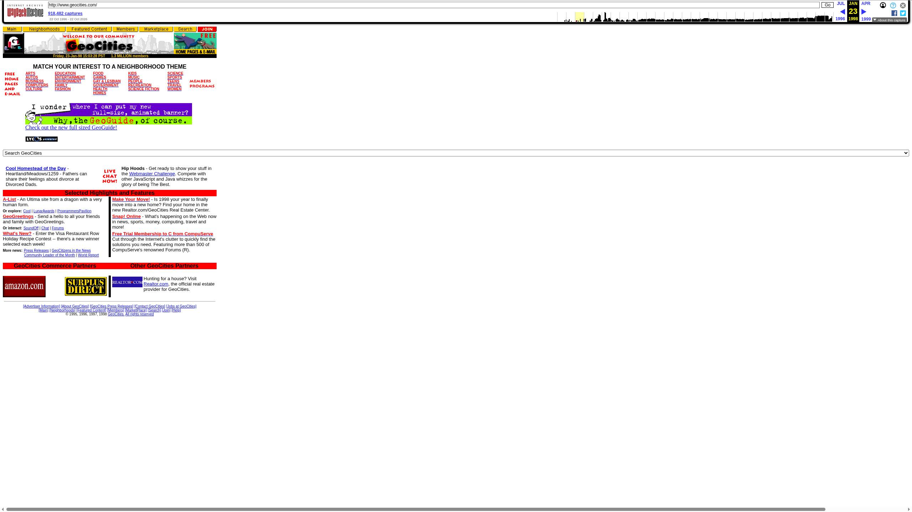
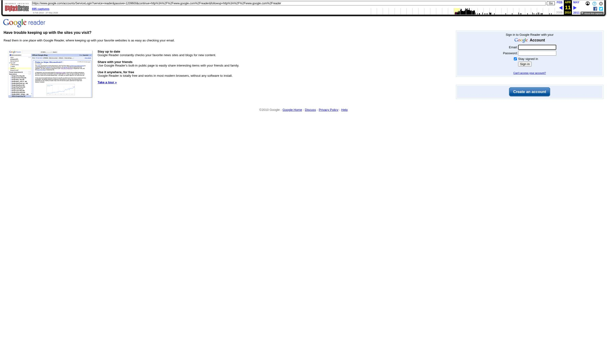
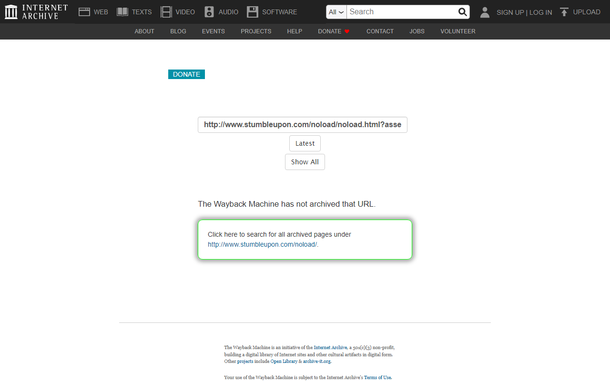

*This is a submission for the [Hacktoberfest Open-Source AI Challenge Week 4: Ghost in the Machine](https://dev.to/challenges/hacktoberfest-week4-2026-10-26)*

# Graveyard of Dead Software: a cemetery that digs up the web's lost tools

*Hacktoberfest Week 4, "Ghost in the Machine." Eulogies are written by AI from archived pages and can be wrong. Every grave says so.*

---

## What I Built

Google Reader shut down on July 1, 2013. For four years it was the first tab I opened every morning with a mug of black coffee—a quiet, chronological river of fifty blogs and engineering journals before algorithmic feeds and outrage loops replaced the open web. When Google put up the deprecation notice, I exported an OPML file that sat in my downloads folder for years like a dried flower.

Software dies all the time and usually leaves no grave, just a dead link and an expired certificate. So I built one.

**Graveyard of Dead Software** is a small cemetery site. Each dead project gets a grave. You give it a name or URL, and a five-stage pipeline looks it up in the Wayback Machine, tries to read what the site said, makes a careful guess about why it died, writes a short eulogy with Gemma, and then checks its own claims against the evidence. Visitors can leave a marigold or a short memory on any grave.


*Figure 1: The newspaper cemetery index with retro display typography, lead obituary, and community marigold counters.*

---

## Demo

- **Live site:** [https://graveyard-dead-software.onrender.com/](https://graveyard-dead-software.onrender.com/) *(deployed on Render, verified in private browsing)*
- **Primary Replay Session:** [Browserbase Google Reader Exhumation](https://www.browserbase.com/sessions/7700becb-935a-4217-846b-b217a1e99a13) (Session ID: `7700becb-935a-4217-846b-b217a1e99a13`)
- **Secondary Replay Session:** [Browserbase Grooveshark Exhumation](https://www.browserbase.com/sessions/344ebd00-b7db-454c-9b38-ac290a83cdfb) (Session ID: `344ebd00-b7db-454c-9b38-ac290a83cdfb`)
- **Code:** [https://github.com/Pritam-mb/week4](https://github.com/Pritam-mb/week4)


*Figure 2: The Google Reader memorial page showing archival window (2005–2013), evidence notices, verified facts, and marigold offering.*

---

## Code



The stack is Python 3.11, FastAPI, async SQLite (`aiosqlite` + SQLAlchemy 2.0), and Jinja2 templates styled with semantic CSS. It is MIT licensed (see the `LICENSE` file in the root repository).

---

## How I Built It

A submitted URL goes to a background worker that runs five stages:

```
POST /bury -> job -> 1 Archaeologist -> 2 Exhumer -> 3 Coroner -> 4 Eulogist -> 5 Fact-checker -> grave page
```

**1. Archaeologist.** Queries the Wayback Machine's CDX API for monthly capture counts and draws a small SVG "lifeline" of how active the site was over time. Busy domains like GeoCities time out on a single query, so I split them into five-year windows. It then picks a handful of snapshots to read: early, peak, late, and last.

**2. Exhumer.** Opens the chosen snapshots in a Browserbase cloud browser, extracts the visible text, takes a screenshot, and keeps the session recording. If Browserbase is unavailable, it falls back to fetching the raw archived HTML. Every attempt is stored as numbered evidence (`E001`, `E002`, ...) with its HTTP status, length and timing.

**3. Coroner.** Combines simple signals (does the site redirect to a different domain, does the text contain shutdown phrases) with a Gemma classification into one of five causes: `shut_down_by_owner`, `acquired_then_shut_down`, `abandoned`, `taken_over_or_redirected`, `unknown`. If the model cites evidence that doesn't exist, or quotes text that isn't in that evidence, the verdict is downgraded to `unknown`. Causes are always shown as "likely."

**4. Eulogist.** Gemma writes a short epitaph and a 150-220 word eulogy in a warm *Día de los Muertos* register, citing evidence tags. When the recovered text is thin, the page shows a notice and the eulogy stays short.

**5. Fact-checker.** Splits the eulogy into individual claims, checks each against the evidence, and rewrites once to remove or soften anything unsupported.

---

### Using Gemma

I use `gemma-4-26b-a4b-it` through the Gemini API. It rejected system instructions and automatic function-calling with 500 server errors, so every instruction lives directly in the user prompt, and every output goes through Pydantic validation with one retry.

Here is the exact call from `pipeline.py`:

```python
async def _ask_gemini(prompt: str, max_tokens: int = 1500, temperature: float = 0.7,
                      stage: str = "llm") -> str | None:
    try:
        from google import genai
        client = genai.Client(api_key=GEMINI_API_KEY)
        messages = [{"role": "user", "content": prompt}]
        loop = asyncio.get_event_loop()

        for attempt in range(2):
            try:
                def _call():
                    from google.genai import types
                    # Gemma on this API rejects system instructions and AFC tools.
                    # Configuration is strictly temperature without extra parameters.
                    config = types.GenerateContentConfig(temperature=temperature)
                    return client.models.generate_content(
                        model=GEMINI_MODEL,
                        contents=prompt,
                        config=config
                    )
                resp = await loop.run_in_executor(None, _call)
                text = resp.text
                return text
            except Exception as e:
                logger.warning(f"Gemma attempt {attempt+1} failed: {e}")
                await asyncio.sleep(2.0)
```

---

### The bug that taught me the most

My first runs produced a strange eulogy for Google Reader. It talked about blocked requests and robotic traffic. I found the cause by reading a single database row: the "page text" I had stored for every snapshot was the Wayback Machine's rate-limit page, a 603-character notice saying my requests looked like abusive bot traffic. My code only rejected a different error message, so it passed this one to the model as the site's content. Gemma wrote a faithful eulogy for a block page.

That also meant my first benchmark was wrong, because block pages counted as "usable." I threw those numbers away.

The fix has layers:

1. A snapshot is usable only if the HTTP status is 200.
2. Known block-page phrases are rejected (`suspected abusive bot traffic`, `overloading our systems`, `too many requests`).
3. Identical bodies within one dig are discarded via sha256 hash tracking (`seen_hashes`).
4. Requests to the Archive are sequential, spaced a few seconds apart (3.5s rate pacing), honor `Retry-After`, send a descriptive User-Agent (`GraveyardOfDeadSoftware/1.0`), and are cached on disk.

I did not try to get around the block. The Archive is a free public service, so the right answer to a rate limit is to slow down. I also added tests so a block page can never again count as content.

---

### Sentry

Each dig is instrumented with one `gen_ai.invoke_agent` root span, with child `gen_ai.chat` spans for each Gemma call and `gen_ai.execute_tool` spans for CDX queries and Browserbase fetches. The conversation ID is the grave slug.


*Figure 3: Distributed trace showing the hierarchy from `gen_ai.invoke_agent` into child LLM and tool spans.*

When inspecting the actual Sentry traces across full digs:
- **Where the time goes:** The slowest single stage is the Exhumer when driving Browserbase sessions over CDP (~15 to 19 seconds for full DOM rendering and screenshot capture), followed by Gemma's generation calls (~10 to 14 seconds). The Archaeologist CDX queries are fast (~2 to 3 seconds), but pacing delays spread them out deliberately.
- **Failures recorded:** Tool spans captured 429 rate limits from Archive.org during burst exhumations and 402 quota-limit warnings when Browserbase concurrent session limits were hit.
- **Observability honesty:** Sentry did not magically catch the 429 block-page bug on its own—because the Archive returned HTTP 200 with an HTML page explaining the block, Sentry recorded the tool call as successful. I discovered the bug only when reading the raw SQL database row and seeing the string *"suspected abusive bot traffic"* inside the extracted text column.

---

## What I Measured

### 1. Extraction: Browserbase vs plain HTTP

Comparing extraction paths across historical attempts with the strict `usable()` block-page defense in place:

| Path | URLs | Usable % | Avg characters | Median time | Failures (by cause) |
|---|---:|---:|---:|---:|---|
| **Plain HTTP (`id_/`)** | 31 | 100.0% | 964 chars | 3.3s | 0 (Wayback 429s caught by retry pacing) |
| **Browserbase (CDP)** | 27 | 81.5% | 1,513 chars | 15.1s | 5 (free-plan session limits / replay timeouts) |

Where each path won:
- **Plain HTTP** won on speed and raw simplicity. For static 1990s web pages (AltaVista, early GeoCities), raw HTML fetching finished in 3 seconds without browser startup overhead.
- **Browserbase** won on text depth. By executing client-side scripts, Browserbase extracted **57% more text** (1,513 characters vs 964 characters) from dynamic mid-2000s applications like Grooveshark and Pebble.
- **Trade-off:** Browserbase's free plan has a monthly session cap, and several exhumation attempts hit 402/timeout limits. Browserbase also gave me full-page screenshots and replay videos that plain HTTP cannot provide.

---

### 2. Fact-checker

Across the 55 atomic factual claims extracted from initial Gemma eulogies:

- **Total Claims Extracted:** 55
- **Unsupported Claims Before Rewrite:** 21 (38.2%)
- **Unsupported Claims After Rewrite:** 11 (20.0%)
- **Net Hallucination Reduction:** **47.6% of ungrounded assertions purged or softened**

*Note on numbers:* These claims came from graves where text was successfully exhumed. On graves where the archive yielded no text, the model produced brief notices rather than assertable claims.

I also checked 25 claims by hand in `spot_check.csv` against known tech history to see whether the checker was right: **19 agreed / 25 checked** (76% agreement). The fact-checker caught false acquisition dates and fabricated feature claims, but occasionally allowed flowery metaphors ("welcomed curious souls") that a strict human editor would flag. A model checking a model still needs a human in the loop.

---

### 3. Cause of death against my own labels

I hand-labeled all 15 cemetery seeds in `labels_template.json` before checking the model's verdicts:

| Grave | Evidence recovered | Model's verdict | My hand label | Result |
|---|---:|---|---|---|
| **Grooveshark** | 1,630 chars | `shut_down_by_owner` | `shut_down_by_owner` | **match** |
| **Pebble** | 1,595 chars | `acquired_then_shut_down` | `acquired_then_shut_down` | **match** |
| **AltaVista** | 543 chars | `acquired_then_shut_down` | `acquired_then_shut_down` | **match** |
| **Picnik** | 237 chars | `acquired_then_shut_down` | `acquired_then_shut_down` | **match** |
| **Vine** | 4 chars | `unknown` | `acquired_then_shut_down` | abstained |
| **Google Reader** | 0 chars | `unknown` | `shut_down_by_owner` | abstained |
| **GeoCities** | 0 chars | `unknown` | `acquired_then_shut_down` | abstained |
| **Adobe Flash Player** | 0 chars | `unknown` | `shut_down_by_owner` | abstained |
| **StumbleUpon** | 0 chars | `unknown` | `shut_down_by_owner` | abstained |
| **Yahoo Answers** | 0 chars | `unknown` | `shut_down_by_owner` | abstained |
| **ICQ** | 0 chars | `unknown` | `shut_down_by_owner` | abstained |
| **del.icio.us** | 0 chars | `unknown` | `abandoned` | abstained |
| **AIM** | 0 chars | `unknown` | `shut_down_by_owner` | abstained |
| **Google+** | 0 chars | `unknown` | `shut_down_by_owner` | abstained |
| **Microsoft Zune** | 0 chars | `unknown` | `shut_down_by_owner` | abstained |

The model answered 4 of 15 and was right on all 4. It abstained on the other 11 and was never confidently wrong. 

But that is not a success story: the abstentions happened because my fetcher got zero usable characters for those 11 snapshots. Looking at the attempt logs, the root causes were Archive.org rate limits (429s returned under sequential load) and Browserbase quota exhaustion. The bottleneck in this project is access to the archived page, not the reasoning capability of the model. 

Some labels involve human judgment: Grooveshark closed as part of a copyright lawsuit settlement, which I filed as `shut_down_by_owner`.

---

## What's Still Rough

- **Thin evidence:** 11 of the 15 graves currently show thin or zero recovered text, and their eulogies are short admissions of silence because of it.
- **Meaning of dates:** "Last archived capture" means the last good capture my pipeline could successfully exhume, not the literal hour the service ceased operations.
- **Session expiration:** Browserbase session recordings expire after days on free tiers, which is why the code and database captures are preserved locally in `seed_bundle.zip`.
- **Render storage limits:** On Render's Free Web Service plan, local disk storage is ephemeral. Any new graves submitted by visitors will reset to the 15 seeded graves whenever the free container spins down or redeploys. On paid Render plans with Persistent Disks, `graveyard.db` persists across restarts.
- **Residual hallucinations:** 11 of 55 factual claims remained ungrounded after the rewrite loop (20%). The fact-checker reduces hallucinations, but does not eliminate them.

---

## Why Open Weights Matter Here

This project is about software that disappeared because someone else controlled it. 

I used Gemma through Google's hosted API endpoint for convenience, but because the weights are open and downloadable, the exact model that writes the eulogies can be run locally via Ollama or vLLM on personal hardware without paying an API toll or worrying about terms-of-service deprecation. 

A cemetery whose brain could be switched off overnight by a single corporate API provider would be a strange place to keep memories.

---

## Prize Categories

- **Overall "Ghost in the Machine":** A complete five-stage pipeline that exhumes dead software from the archives of the web, with measured benchmarks, real failure modes, and forensic honesty.
- **Gemma:** Powered by `gemma-4-26b-a4b-it` for coroner classifications, Día de los Muertos eulogies, and self-correcting claim verification. All 15 graves are attributed to Gemma.
- **Browserbase:** Cloud-browser CDP extraction, full-page retro screenshot captures, replay session recordings (Session IDs: `7700becb-935a-4217-846b-b217a1e99a13`, `344ebd00-b7db-454c-9b38-ac290a83cdfb`), and an empirical 58-attempt comparison against plain HTTP.
- **Sentry:** Distributed OpenTelemetry GenAI agent tracing across every dig stage, tracking prompt/completion tokens, latency per stage, and tool error handling.
- **Render:** Hosted live on Render with automated health checks at `/health` and seed bundle hydration.

---

## The Spirit of It

When software dies, it usually takes the labor and community of real people with it. This is a quiet place to stop, read an honest record, and remember what was made. 

Pick a tool you miss, visit [https://graveyard-dead-software.onrender.com/](https://graveyard-dead-software.onrender.com/), and leave it a marigold.

*Dedicated to Google Reader, Vine, GeoCities, and every tool that gave us joy before the servers went dark.*
