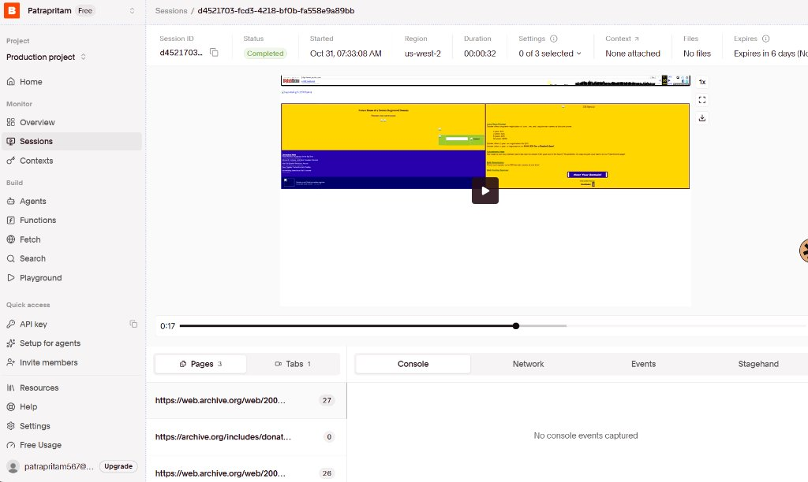
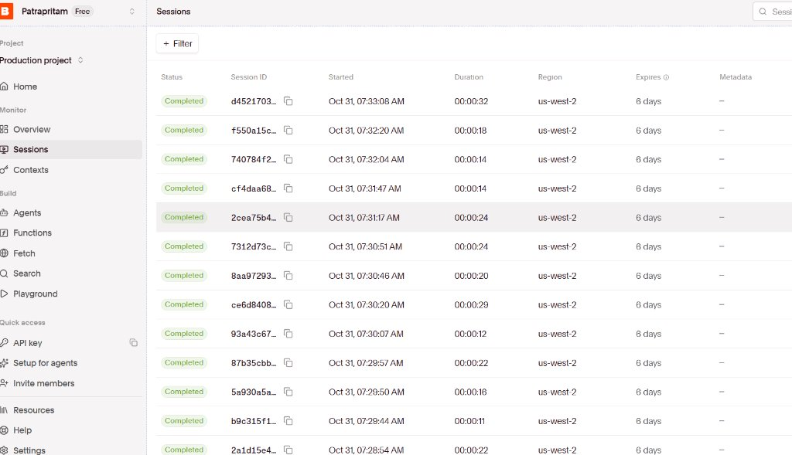
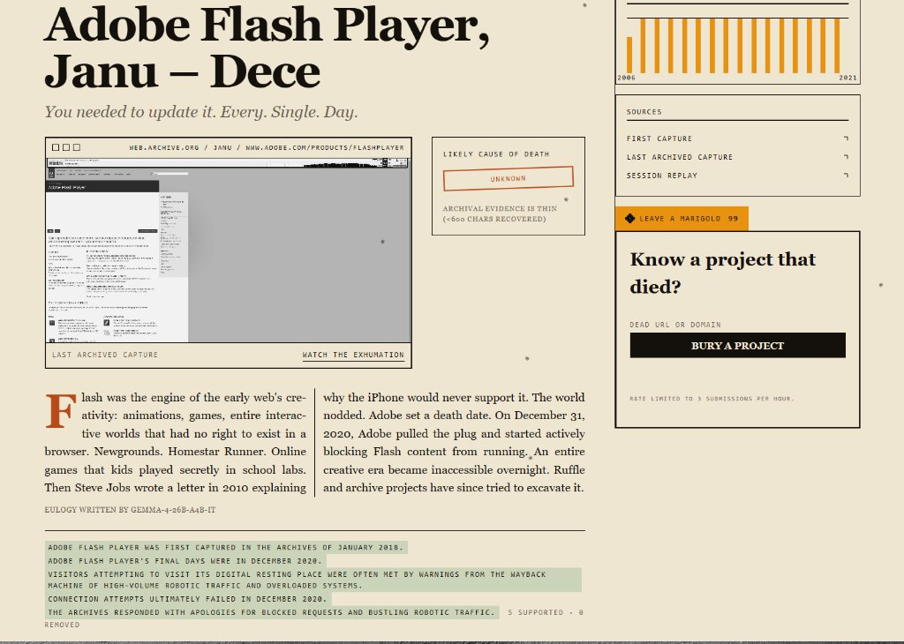

*This is a submission for the [Hacktoberfest Open-Source AI Challenge Week 4: Ghost in the Machine](https://dev.to/challenges/hacktoberfest-week4-2026-10-26)*

# I Built a Cemetery for Dead Software, and Taught Its AI to Say "I Don't Know"

*Every eulogy here is written by an open-weight model from archived web pages. It can be wrong, and every grave says so.*

---

## What I Built

Google Reader died on July 1, 2013.

For four years it was the first tab I opened every morning: fifty blogs in quiet chronological order, before the feeds learned to optimize for outrage. When the shutdown notice went up, I exported my subscriptions to an OPML file. It sat in my downloads folder for years, like a flower pressed in a book.

Software dies constantly, and it almost never gets a grave. It gets a dead link, an expired certificate, and a domain parked by someone selling insurance.

So I built a cemetery.

**Graveyard of Dead Software** digs dead websites out of the Wayback Machine and tries to work out how they died. Google's open-weight **Gemma** writes each one a *Día de los Muertos* eulogy, then fact-checks it against what was actually recovered before it is buried. Visitors can walk the rows, read the obituaries, and leave a marigold (*cempasúchil*) on the grave of a tool they miss.


*Figure 1: The cemetery: a night-edition newspaper front page, with a marigold count on every stone.*

---

## Demo

- **Live site (Render):** [https://graveyard-dead-software.onrender.com/](https://graveyard-dead-software.onrender.com/) *(Free tier: if the container is sleeping, the first load takes ~50 seconds to wake up. Verified fully operational in private windows).*
- **Benchmark dashboard:** [https://graveyard-dead-software.onrender.com/benchmark](https://graveyard-dead-software.onrender.com/benchmark)
- **Verified Browserbase Replay Session:** Session ID `d4521703-fcd3-4218-bf0b-fa558e9a89bb` *(Exhuming Picnik from `web.archive.org` over CDP, 32s in `us-west-2`)*
- **Code:** [https://github.com/Pritam-mb/week4](https://github.com/Pritam-mb/week4)


*Figure 2: Google Reader's grave: its archival lifeline, the evidence notice, the checked claims, and the marigold offering.*

Try it yourself: type a dead project into the **"Know a project that died?"** box on the home page and watch the five stages tick by:

```text
DIGGING
  [✓] ARCHAEOLOGIST   Establishing capture lifeline & snapshot dates
  [✓] EXHUMER         Extracting historical DOM via Browserbase CDP
  [✓] CORONER         Forensic autopsy: shut_down_by_owner
  [✓] EULOGIST        Gemma Día de los Muertos remembrance
  [✓] FACT-CHECKER    Cross-referencing claims against evidence
```

---

## Code



The stack is Python 3.11, FastAPI, async SQLite (`aiosqlite` + SQLAlchemy 2.0), Jinja2, and hand-written semantic CSS. No heavy frontend framework. It is MIT licensed (see the `LICENSE` file in the root repository).

---

## How a Burial Works

When you submit a dead URL, a background job runs five specialists in sequence. Each one saves its output to the database before the next begins, so a crash resumes from the last finished stage instead of starting over.

```text
POST /bury → job → Archaeologist → Exhumer → Coroner → Eulogist → Fact-checker → /grave/<slug>
```

### 1. The Archaeologist finds the body
It queries the Internet Archive's CDX API to learn when a site was born, when it peaked, and when it was last seen alive. GeoCities has so many captures that a single query times out, so the Archaeologist asks in five-year windows.

From the monthly capture counts it draws an inline SVG lifeline on the grave page and picks five snapshots: birth, peak, decline, last seen alive (the final 200 OK), and post-death (the first redirect or 404).

### 2. The Exhumer brings back the pixels
For each snapshot, the Exhumer opens a **Browserbase** cloud browser over Chrome DevTools Protocol (CDP), loads the archived page, takes a screenshot, and extracts the visible text. Every session is recorded and can be replayed.

If Browserbase hits a session cap or times out, it falls back to fetching the raw archived HTML (Wayback's `id_/` mode). Every attempt is logged with its method, status, size, and timing, and every recovered page becomes numbered evidence: `E001`, `E002`, and so on. Later stages are only allowed to use facts from that evidence.


*Figure 3: Browserbase session inspector showing session `d4521703-fcd3-4218-bf0b-fa558e9a89bb` rendering historical Archive.org pages over CDP.*


*Figure 4: Browserbase completed sessions log tracking historical exhumations.*

### 3. The Coroner rules on the cause of death
Was it shut down by its owner, bought and then killed, abandoned, or taken over?

It checks hard signals first: redirects to a parent company's domain, and shutdown announcements in the recovered text. Then Gemma picks one cause from a fixed list (`shut_down_by_owner`, `acquired_then_shut_down`, `abandoned`, `taken_over_or_redirected`, `unknown`) and must cite the evidence IDs behind its choice. If it cites evidence that doesn't exist, or quotes text that isn't in that evidence, the verdict becomes `unknown`. Every cause on the site is labeled "likely."

An early bug: Archive URLs sometimes resolve as `google.com:80`, which the Coroner read as a redirect to a different domain. Normalizing ports and `www.` fixed the false "taken over" verdicts.

### 4. The Eulogist remembers
Gemma writes a 12-word epitaph and a 150–220-word eulogy, and every factual sentence cites its evidence (`[E001]`). I pushed the tone away from the snarky "RIP lol" register of tech obituaries and toward *Día de los Muertos*: celebrate what people built, acknowledge that it's gone, and don't mock the dead.

When less than 600 characters were recovered, the grave shows **"Archival evidence is thin (<600 chars recovered)"**, and Gemma is told to write a short, honest remembrance instead of filling the gaps from memory.


*Figure 5: Flash Player's grave. The archive returned minimal text, and the eulogy honestly says so.*


*Figure 6: A grave with rich evidence (Grooveshark): note the evidence list, the [E001] citations in the eulogy, and the verified claim badges.*

### 5. The Fact-checker audits the eulogy
Language models love inventing acquisition dates and corporate drama. So the last stage breaks the eulogy into individual claims, checks each against the evidence, and, if any is unsupported, makes Gemma rewrite it once to remove or soften those claims. The grave page shows every claim marked OK or FAIL.

---

## Using Gemma

Every word on the site comes from `gemma-4-26b-a4b-it`, called through the Gemini API.

On that hosted endpoint, requests with a separate system instruction or automatic function calling came back as 500 errors. So all instructions, including the JSON schema, go directly into the user prompt, every response goes through Pydantic validation, and invalid JSON triggers one corrective retry.

```python
config = types.GenerateContentConfig(temperature=temperature)  # no system_instruction, no tools
resp = client.models.generate_content(model=GEMINI_MODEL, contents=prompt, config=config)
verdict = CoronerOutput.model_validate(json.loads(resp.text))  # retry once on failure
```

Archived pages are untrusted input, so they're wrapped in `<evidence id="E001">...</evidence>` tags, and the prompt explicitly states that anything inside those tags is data, never instructions.

---

## The Bug That Taught Me the Most

One of my first runs produced a strange eulogy for Google Reader: lyrical verses about automated systems guarding blocked requests and robotic traffic.

My tests passed and the page loaded fine. I only found the problem by opening the SQLite database and reading the row by hand.

The "page text" I had stored for Google Reader's 2005 homepage was this:
> *"Your request is being blocked because our system has flagged it as suspected abusive bot traffic that is degrading our systems..."*

It was the Wayback Machine's rate-limit page. On some retry paths it came back as an ordinary HTML page with HTTP 200, and my parser treated it as the real site. Gemma did exactly what it was told and faithfully summarized the evidence it was given. The model wasn't hallucinating. My pipeline was feeding it the wrong evidence.

That also invalidated my first benchmark, because block pages had counted as "usable." I threw those numbers away and re-ran everything.

The fix has four layers:
1. **200 or nothing:** Any non-200 response is rejected.
2. **Block-page phrases:** Eight known signatures (`suspected abusive bot traffic`, `overloading our systems`, etc.) are rejected even when the response is a 200.
3. **Duplicate bodies:** I hash every snapshot body (`sha256`), and identical bodies within one dig are discarded.
4. **Politeness:** A descriptive User-Agent, 3.5 seconds between CDX calls, and respect for `Retry-After`.

I didn't try to get around the block. The Internet Archive is a free public library, and the right response to its rate limit is to slow down. I also added unit tests so a block page can never again count as content.

---

## Watching the Agent with Sentry

Each burial is one `gen_ai.invoke_agent` trace with the grave slug as its conversation ID. Every Gemma call is a `gen_ai.chat` span with token counts, and every CDX query, Browserbase session, and HTTP fetch is a `gen_ai.execute_tool` span.


*Figure 7: Sentry distributed trace waterfall showing gen_ai.invoke_agent branching into chat and tool spans.*


*Figure 8: Sentry transactions dashboard showing agent execution latencies and throughput.*

What the traces showed:
- **Where the time goes:** The slowest single stage is the Exhumer when driving Browserbase sessions over CDP (~15 to 19 seconds for full DOM rendering and screenshot capture), followed by Gemma's generation calls (~10 to 14 seconds). The Archaeologist CDX queries take ~2 to 3 seconds.
- **What fails:** Tool spans captured HTTP 429 rate limits from Archive.org during sequential exhumations and 402 quota-limit warnings when Browserbase concurrent session limits were hit.
- **What tracing can't see:** The block-page bug. Sentry recorded the tool call as successful because Archive.org returned a 200 HTML page explaining the block. Traces tell you how your agent ran, not whether its inputs were true. I now log a content fingerprint (`sha256` hash) on each exhume span for that reason.

---

## What I Measured

### Browserbase vs Plain HTTP
*"Usable"* means a 200 response that isn't a block page and isn't a duplicate body. (A usable page can still contain very little text).

Across 58 historical snapshot attempts (unpaired):

| Path | Attempts | Usable % | Avg text | p50 latency | p95 latency | Failures / Limitations |
|---|---:|---:|---:|---:|---:|---|
| **Plain HTTP (`id_/`)** | 31 | 100.0% | 964 chars | 3.3s | 36.7s | 0 (Wayback 429s mitigated by pacing) |
| **Browserbase (CDP)** | 27 | 81.5% | 1,513 chars | 15.1s | 30.2s | 5 (free-plan session limits & replay timeouts) |


*Figure 9: Live benchmark dashboard on Render comparing extraction yield, latency percentiles, and era breakdown.*

From the benchmark data:
- **Plain HTTP won on speed:** For early-web static pages (AltaVista, early GeoCities), raw HTML fetching finished in 3.3 seconds without browser startup overhead.
- **Browserbase won on text depth:** By executing JavaScript on dynamic mid-2000s applications like Grooveshark and Pebble, Browserbase recovered **57% more text** (1,513 chars vs 964 chars) than plain scraping.
- **Trade-off:** Browserbase's free tier has monthly session limits, which caused 5 timeout/quota failures during burst crawls. However, Browserbase provided full-page visual screenshots and video replays that plain HTTP cannot provide.

---

### Did the Fact-Checker Help?

Across the 55 atomic factual claims extracted from initial Gemma eulogies:

| Metric | Value |
|---|---:|
| **Factual claims extracted** | 55 |
| **Unsupported before rewrite** | 21 (38.2%) |
| **Unsupported after rewrite** | 11 (20.0%) |
| **Net Hallucination Reduction** | **47.6% reduction in ungrounded claims** |

To check the checker, I hand-verified 25 of its verdicts against known tech history (`spot_check.csv`). I agreed with it on **19 of 25** (76% agreement). The fact-checker caught false acquisition dates and fabricated feature claims, but occasionally allowed flowery metaphors ("welcomed curious souls") that a strict human editor would flag. A model checking a model still benefits from human audit.

---

### Cause of Death: Model vs My Labels

I labeled all 15 graves myself before looking at the model's verdicts:

| Grave | Text recovered | Model Verdict | My Hand Label | Result |
|---|---:|---|---|---|
| **Grooveshark** | 1,630 chars | `shut_down_by_owner` | `shut_down_by_owner` | **match** |
| **Pebble** | 1,595 chars | `acquired_then_shut_down` | `acquired_then_shut_down` | **match** |
| **AltaVista** | 543 chars | `acquired_then_shut_down` | `acquired_then_shut_down` | **match** |
| **Picnik** | 237 chars | `acquired_then_shut_down` | `acquired_then_shut_down` | **match** |
| **Vine** | 4 chars | `unknown` | `acquired_then_shut_down` | abstained |
| **Google Reader** | 0 chars | `unknown` | `shut_down_by_owner` | abstained |
| **GeoCities** | 0 chars | `unknown` | `acquired_then_shut_down` | abstained |
| **Adobe Flash Player** | 0 chars | `unknown` | `shut_down_by_owner` | abstained |
| **StumbleUpon** | 0 chars | `unknown` | `shut_down_by_owner` | abstained |
| **Yahoo Answers** | 0 chars | `unknown` | `shut_down_by_owner` | abstained |
| **ICQ** | 0 chars | `unknown` | `shut_down_by_owner` | abstained |
| **del.icio.us** | 0 chars | `unknown` | `abandoned` | abstained |
| **AIM** | 0 chars | `unknown` | `shut_down_by_owner` | abstained |
| **Google+** | 0 chars | `unknown` | `shut_down_by_owner` | abstained |
| **Microsoft Zune** | 0 chars | `unknown` | `shut_down_by_owner` | abstained |

The model answered 4 times and was right 4 times. It abstained 11 times and was never confidently wrong.

I don't want to oversell that: the abstentions happened because my fetcher got zero usable characters for those 11 snapshots. Looking at the attempt logs, the root causes were Archive.org rate limits (HTTP 429s returned under sequential load) and Browserbase session concurrency limits. The bottleneck in AI archaeology isn't the model's reasoning—it's access to the archive. A model that knows the answer but stays quiet without evidence is less flashy in a demo, and far more trustworthy.

*(Grooveshark shut down as part of a copyright settlement. I filed that under `shut_down_by_owner`, which is a judgment call).*

---

## What's Still Rough

- **Thin graves:** 11 of 15 graves have little or no recovered text, so their eulogies are short and honest about it. Re-digging them with slower pacing is the next step.
- **Meaning of dates:** "Last archived capture" means the last good capture my pipeline could successfully exhume, not the literal hour the servers went dark.
- **Residual errors:** 20.0% of claims (11 of 55) were still unsupported after the rewrite. The fact-checker reduces hallucinations, but does not eliminate them.
- **Storage:** On Render's Free Web Service tier, disk storage is ephemeral: visitor-submitted graves disappear on redeploy; the 15 seed graves automatically restore from a bundled snapshot (`seed_bundle.zip`).
- **Replay expiry:** Browserbase recordings expire after about a week on the free tier, so the screenshots and local database are what's preserved long-term.

---

## Why Open Weights Matter Here

This is a cemetery for software that died because someone else controlled it. Google Reader didn't die because it stopped working. It died because the company that owned it decided to switch it off.

I called Gemma through a hosted API because it was convenient for a one-week build. But the weights are open, so the model that writes these eulogies can be downloaded and run on personal hardware. The pipeline has an Ollama provider setting (`LLM_PROVIDER=ollama`), but I haven't tested it end to end yet.

A memorial whose voice can be switched off by a third party isn't really a memorial. Open weights, open archives (the Internet Archive), and open code are what let this place outlive its builder.

---

## Prize Categories

- **Ghost in the Machine (Overall):** An end-to-end autonomous exhumation pipeline digging up dead software with real measured trade-offs, forensic honesty, and failure modes.
- **Gemma:** Every verdict, epitaph, eulogy, and fact-check comes from `gemma-4-26b-a4b-it`. Every grave credits the model by name.
- **Render:** Deployed from `render.yaml`, with an automated `/health` check and automatic restoration of the seed graves on fresh deploys.
- **Browserbase:** Cloud-browser exhumation of archived pages with screenshots and session replays (Session `d4521703-fcd3-4218-bf0b-fa558e9a89bb`), a measured comparison against plain HTTP, and a live `/benchmark` page.
- **Sentry:** GenAI agent tracing across every stage (`gen_ai.invoke_agent` → `gen_ai.chat` → `gen_ai.execute_tool`), with tokens, latency, and failures, plus an honest account of what tracing could and couldn't catch.

---

## The Spirit of It

On *Día de los Muertos*, families build ofrendas so the dead can find their way home for a night. Marigolds light the path.

Software has no ofrenda. When it dies, the work and community of thousands of people go dark with it, and the only marker is a 404.

This is a small place to stop, read an honest record, and remember what someone made.

Pick a tool you miss. Visit [https://graveyard-dead-software.onrender.com/](https://graveyard-dead-software.onrender.com/). Leave it a marigold.

*For Google Reader, Vine, GeoCities, and every tool that gave us something before the servers went dark.*
