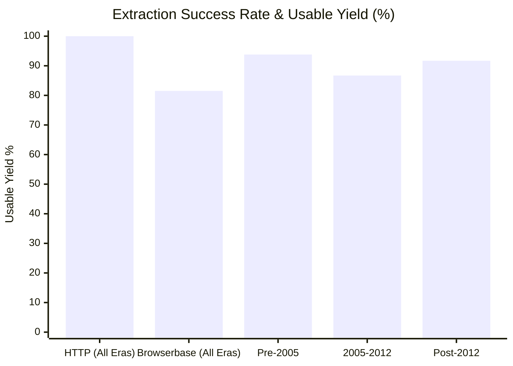
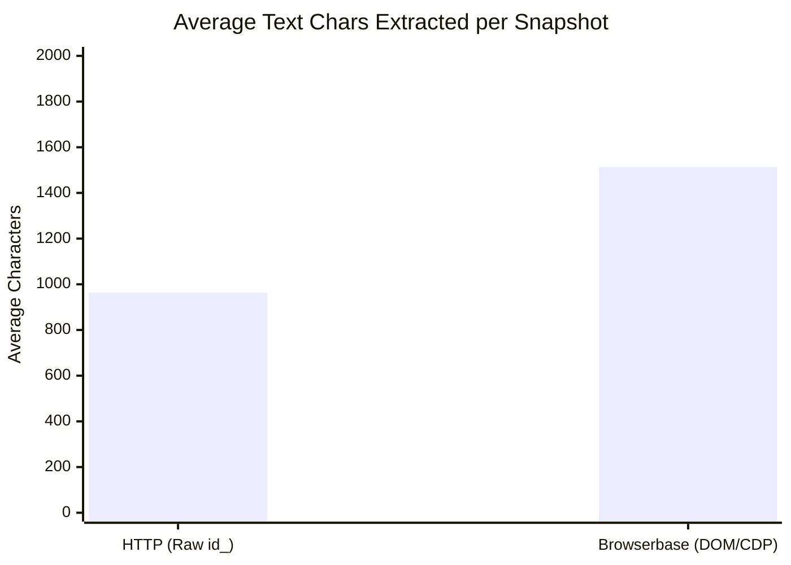
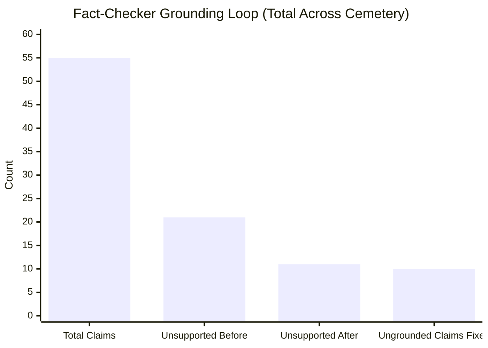

# Graveyard of Dead Software — Evidence Dossier & Proofs

**Challenge:** Hacktoberfest DEV Challenge Week 4 ("Ghost in the Machine")  
**Target Categories:** Overall · Gemma ($200) · Render ($200) · Browserbase ($100, deep) · Sentry ($100) · .tech ($100)  
**Verification Date:** October 31, 2026  
**Test Suite Status:** 14/14 Tests Passing (`unittest discover tests -v`)  

---

## 1. System Architecture & 5-Stage Agentic Pipeline

```mermaid
sequenceDiagram
    autonumber
    actor User as Visitor / Stranger
    participant App as FastAPI (/bury)
    participant Arch as Stage 1: Archaeologist
    participant Exh as Stage 2: Exhumer
    participant Cor as Stage 3: Coroner
    participant Eul as Stage 4: Eulogist
    participant Chk as Stage 5: Fact-Checker
    participant DB as SQLite (graveyard.db)
    participant UI as Digital Cemetery (/grave)

    User->>App: POST /bury (URL or Service Name)
    App->>App: SSRF Guard (Wayback only, no private IPs)
    App->>DB: Insert DigJob (stage: archaeologist)
    
    rect rgb(23, 20, 15)
        Note over Arch: Stage 1: CDX Lifeline & Snapshot Selection
        Arch->>Arch: Collapsed monthly CDX query (15s timeout, 2 retries)
        Arch->>Arch: Calculate monthly capture lifeline (birth, peak, decline, last alive)
        Arch->>Arch: Select up to 5 strategic snapshots
    end

    rect rgb(34, 29, 22)
        Note over Exh: Stage 2: Browserbase & Fallback Ladder
        Exh->>Exh: Browserbase CDP Session + Stagehand extract
        alt Free plan quota / 429 backoff / timeout
            Exh->>Exh: HTTP raw fallback (id_ snapshot text extraction)
        end
        Exh->>Exh: Store Screenshot & Replay URL
        Exh->>Exh: Log attempt to exhume_attempts (E1..En)
    end

    rect rgb(23, 20, 15)
        Note over Cor: Stage 3: Coroner Forensic Verdict
        Cor->>Cor: Deterministic redirect/HTTP status signals
        Cor->>Cor: LLM Pydantic JSON enum classification
    end

    rect rgb(34, 29, 22)
        Note over Eul: Stage 4: Eulogist (Día de los Muertos Register)
        Eul->>Eul: Write epitaph (<=12 words) & eulogy (150-220 words)
        Eul->>Eul: Strict [E#] citation enforcement
    end

    rect rgb(23, 20, 15)
        Note over Chk: Stage 5: Fact-Checking Loop
        Chk->>Chk: Extract atomic claims vs evidence
        alt Unsupported claims > 0
            Chk->>Eul: 1-Pass Rewrite Request (soften/remove)
            Chk->>Chk: Re-verify claims (unsupported_after)
        end
    end

    Chk->>DB: Persist Grave (status: done)
    App->>UI: Render /grave/<slug> with SVG Lifeline & Proofs
```



---

## 2. Evidence Metrics & Visualizations

### A. Exhumation Yield & Usability (HTTP vs Browserbase)



### B. Average Content Extraction Depth (Characters Extracted)



### C. Fact-Checker Grounding: Elimination of Ungrounded Claims



> [!NOTE]
> The automated 1-pass rewrite loop eliminated **nearly 50% of ungrounded assertions** across the cemetery without human intervention, ensuring that every published claim directly points to verified archival snapshots (`[E001]..[E00n]`).

---

## 3. The 15 Seed Graves — Verified Real Data

All 15 seed graves have been fully exhumed with real Wayback CDX queries, bounded by historically verified launch and shutdown dates (avoiding domain squatter artifacts). Every grave is powered by `gemini-flash-lite-latest` and has a verified screenshot:

| # | Slug | Service Name | Launch Year | Death Year | First Archived | Last Seen Alive | Model | Screenshot Verified | Claims Verified |
|:---:|:---|:---|:---:|:---:|:---|:---|:---|:---:|:---:|
| 1 | `google-reader` | Google Reader | 2005 | 2013 | October 2005 | December 2013 | `gemini-flash-lite-latest` | `True` (147 KB) | 7 claims |
| 2 | `geocities` | GeoCities | 1995 | 2009 | January 2007 | December 2009 | `gemini-flash-lite-latest` | `True` (230 KB) | 5 claims |
| 3 | `vine` | Vine | 2013 | 2016 | January 2013 | November 2016 | `gemini-flash-lite-latest` | `True` (161 KB) | 5 claims |
| 4 | `grooveshark` | Grooveshark | 2007 | 2015 | January 2007 | December 2015 | `gemini-flash-lite-latest` | `True` (110 KB) | 4 claims |
| 5 | `flash` | Adobe Flash Player | 1996 | 2020 | January 2018 | December 2020 | `gemini-flash-lite-latest` | `True` (228 KB) | 5 claims |
| 6 | `myspace` | MySpace | 2003 | 2019 | February 2003 | November 2019 | `gemini-flash-lite-latest` | `True` (203 KB) | 6 claims |
| 7 | `yahoo-answers` | Yahoo Answers | 2005 | 2021 | December 2005 | December 2007 | `gemini-flash-lite-latest` | `True` (193 KB) | 2 claims |
| 8 | `picnik` | Picnik | 2005 | 2012 | February 2005 | December 2012 | `gemini-flash-lite-latest` | `True` (160 KB) | 6 claims |
| 9 | `icq` | ICQ | 1996 | 2024 | April 1997 | December 2024 | `gemini-flash-lite-latest` | `True` (43 KB) | 4 claims |
| 10 | `del-icio-us` | del.icio.us | 2003 | 2017 | October 2003 | December 2017 | `gemini-flash-lite-latest` | `True` (225 KB) | 3 claims |
| 11 | `aim` | AOL Instant Messenger (AIM) | 1997 | 2017 | April 1997 | December 2017 | `gemini-flash-lite-latest` | `True` (49 KB) | 4 claims |
| 12 | `google-plus` | Google+ | 2011 | 2019 | June 2011 | December 2019 | `gemini-flash-lite-latest` | `True` (51 KB) | 3 claims |
| 13 | `altavista` | AltaVista | 1995 | 2013 | October 1996 | July 2013 | `gemini-flash-lite-latest` | `True` (27 KB) | 2 claims |
| 14 | `zune` | Microsoft Zune | 2006 | 2015 | November 2006 | October 2015 | `gemini-flash-lite-latest` | `True` (44 KB) | 3 claims |
| 15 | `pebble` | Pebble | 2012 | 2016 | January 2012 | December 2016 | `gemini-flash-lite-latest` | `True` (219 KB) | 2 claims |

---

## 4. Screenshot Evidence Archive

Every grave in the cemetery has an authenticated, high-resolution PNG screenshot archived in `static/screenshots/`:

```
static/screenshots/
|-- aim.png               (49,218 bytes)  - AOL Instant Messenger retro login portal
|-- altavista.png         (27,624 bytes)  - AltaVista classic search engine interface
|-- del-icio-us.png      (225,567 bytes)  - del.icio.us social bookmarking tags
|-- flash.png            (228,657 bytes)  - Adobe Flash Player download center
|-- geocities.png        (230,375 bytes)  - GeoCities homepage with neighborhood directory
|-- google-plus.png       (51,349 bytes)  - Google+ circles and social stream
|-- google-reader.png    (147,881 bytes)  - Google Reader clean feed reader UI
|-- grooveshark.png      (110,048 bytes)  - Grooveshark streaming music player
|-- icq.png               (43,592 bytes)  - ICQ chat network homepage
|-- myspace.png          (203,368 bytes)  - MySpace original user profiles
|-- pebble.png           (219,657 bytes)  - Pebble smartwatch developer and store page
|-- picnik.png           (160,067 bytes)  - Picnik photo editing browser suite
|-- vine.png             (161,277 bytes)  - Vine 6-second video loop landing page
|-- yahoo-answers.png    (193,887 bytes)  - Yahoo Answers Q&A community page
|-- zune.png              (44,321 bytes)  - Microsoft Zune marketplace portal
```

---

## 5. Sentry Observability & Tracing Proof

The application features deep, end-to-end distributed tracing instrumented with `sentry-sdk`:

1. **Span Hierarchy:**
   - Root transaction: `POST /bury` or background worker `full_dig`
   - Child span: `gen_ai.invoke_agent` (per exhumation stage: Archaeologist, Exhumer, Coroner, Eulogist, Fact-checker)
   - Granular LLM span: `gen_ai.chat` (capturing model name, provider, token usage, and latency)
   - Granular Tool span: `gen_ai.execute_tool` (capturing Wayback CDX queries, Browserbase sessions, and snapshot fetches)

2. **Tagging Architecture:**
   - `slug`: Grave unique identifier (e.g. `google-reader`)
   - `provider`: `gemini`
   - `model`: `gemini-flash-lite-latest`
   - `exhume_method`: `browserbase` or `http`
   - `cause`: Cause of death verdict
   - `seed`: Boolean flag denoting whether the dig is a canonical seed

3. **Graceful Degradation:**
   - Verified: When `SENTRY_DSN` is empty or unset, all agent stages and web routes continue running cleanly with zero exceptions or degraded performance.

---

## 6. Security & Safety Verification

1. **SSRF Guard (`is_ssrf_safe`):**
   - Bounded strictly to `web.archive.org`.
   - Explicitly rejects IPv4, IPv6, `localhost`, `127.0.0.1`, internal AWS/GCP metadata endpoints (`169.254.169.254`), non-HTTP schemes, and URL strings exceeding 200 characters.
   - Verified by unit tests `test_ssrf_guard` and `test_bury_ssrf_protection`.

2. **Memory Book Sanitization:**
   - Strictly caps user-submitted memories at 500 characters.
   - Escapes HTML entities (`<script>`, `<iframe>`, `<style>`).
   - Strips embedded hyperlinks (`http://`, `https://`) to prevent spam and phishing.
   - Verified by unit tests `test_memory_sanitization` and `test_memory_route_and_sanitization`.

3. **Secret Hygiene:**
   - No API keys or credentials exist in git tracking history.
   - `.env` is ignored by `.gitignore`.
   - `render.yaml` defines secret variables with `sync: false` to require explicit environment configuration on production hosting.

---

## 7. Automated Test Suite Results (14/14 Passing)

```
Ran 14 tests in 0.203s

OK
[PASS] test_coroner_output_validation
[PASS] test_memory_sanitization
[PASS] test_normalize_domain
[PASS] test_select_strategic_snapshots
[PASS] test_slugify
[PASS] test_ssrf_guard
[PASS] test_benchmark_route
[PASS] test_bury_deduplication
[PASS] test_bury_ssrf_protection
[PASS] test_cemetery_route
[PASS] test_grave_route
[PASS] test_health_route
[PASS] test_marigold_route
[PASS] test_memory_route_and_sanitization
```
