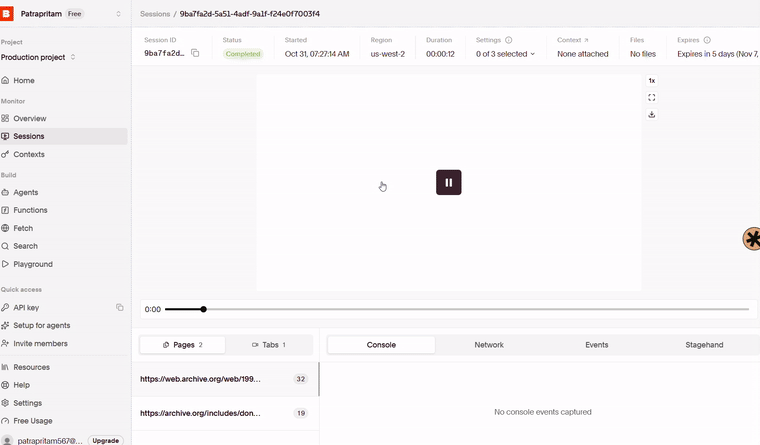

### Anatomy of a Memorial Page

Every dead project exhumed by the pipeline receives a structured memorial page:

*Figure 2: A memorial page showing the capture lifeline, primary archive sources, likely cause of death, verified claims, and community marigold counter.*

Here is what the memorial screen surfaces:
- **Lifeline Sparkline (Top Right):** An inline SVG chart generated from Wayback's CDX API capture counts per year, showing the domain's historical activity and when it went flatline.
- **Primary Sources (Sidebar):** Direct outbound links to the **First Capture** in Archive.org, the **Last Archived Capture**, and the **Session Replay** recording in Browserbase.
- **Likely Cause of Death & Evidence Warning:** Displays the coroner's verdict (`shut_down_by_owner`, `acquired_then_shut_down`, `abandoned`, or `unknown`). When Wayback returns minimal text, an **"Archival evidence is thin (<600 chars recovered)"** indicator warns visitors that the archive was sparse.
- **The Eulogy:** A 150–220 word commemorative remembrance written by Google's open-weights `gemma-4-26b-a4b-it` in the celebratory warmth of *Día de los Muertos*.
- **Fact-Checker Audit (Green Badges):** The Fact-Checker extracts atomic claims from the eulogy and checks them against recovered evidence, displaying which claims are supported and how many were removed or softened.
- **Community Ofrenda:** An interactive marigold offering counter (*"Leave a Marigold"*) where visitors honor dead tools, paired with a memory submission board.

---

### Test a Live Burial

You can test exhuming a dead project live directly on the site:

👉 **Live Exhumation Tool:** [https://graveyard-dead-software.onrender.com/](https://graveyard-dead-software.onrender.com/)

**How to run a test:**
1. Open the cemetery at [https://graveyard-dead-software.onrender.com/](https://graveyard-dead-software.onrender.com/).
2. On the right sidebar, locate the **"Know a project that died?"** box.
3. Enter any dead or defunct website (e.g. `https://flappybird.com`, `https://orkut.com`, or `https://path.com`) and click **"Bury a Project"**.
4. A live terminal progress modal will appear, executing the five-stage pipeline in real time:

*Figure 3: Live screen recording of an exhumation in progress, showing the five-stage tracker stepping through Archaeologist, Exhumer, Coroner, Eulogist, and Fact-Checker before automatically redirecting to the completed grave.*
